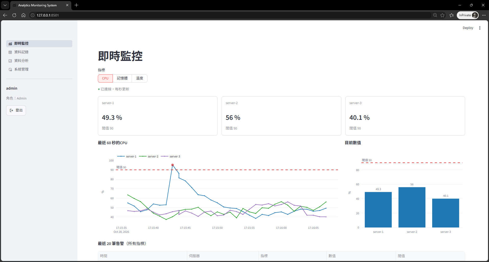
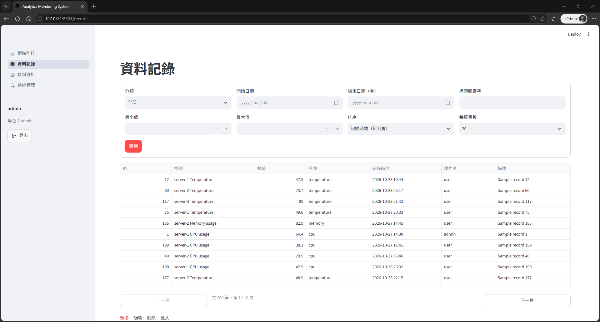
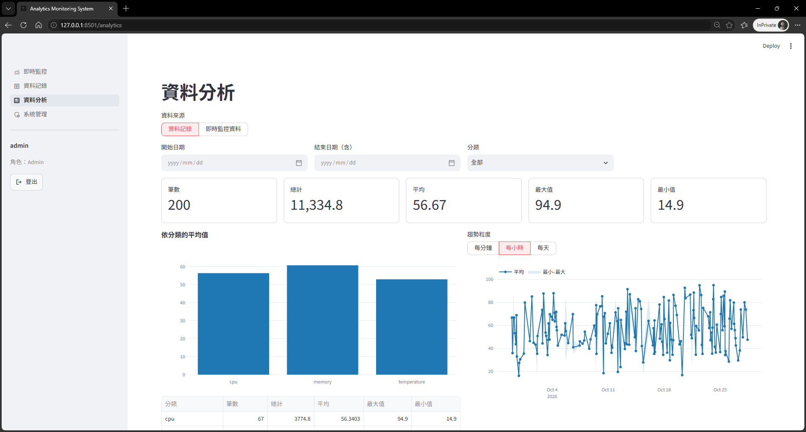
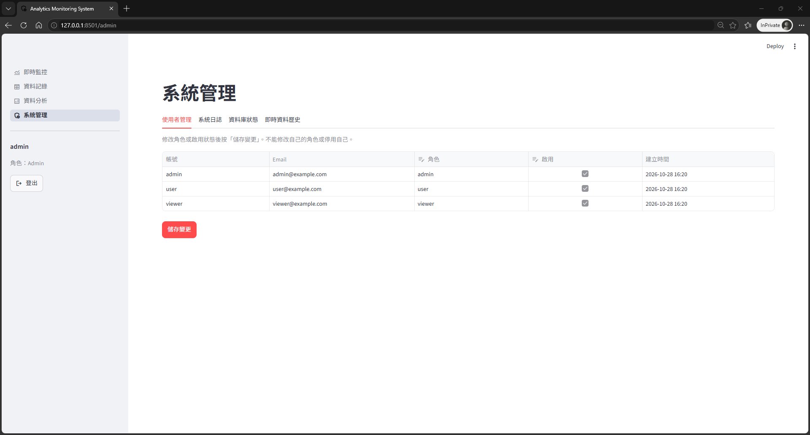
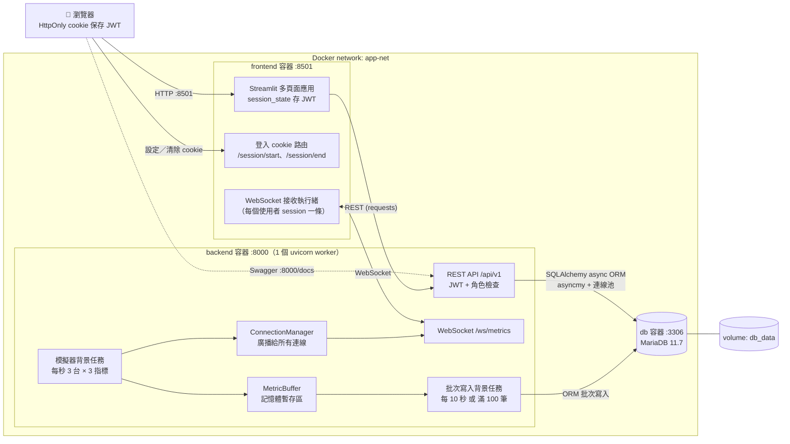
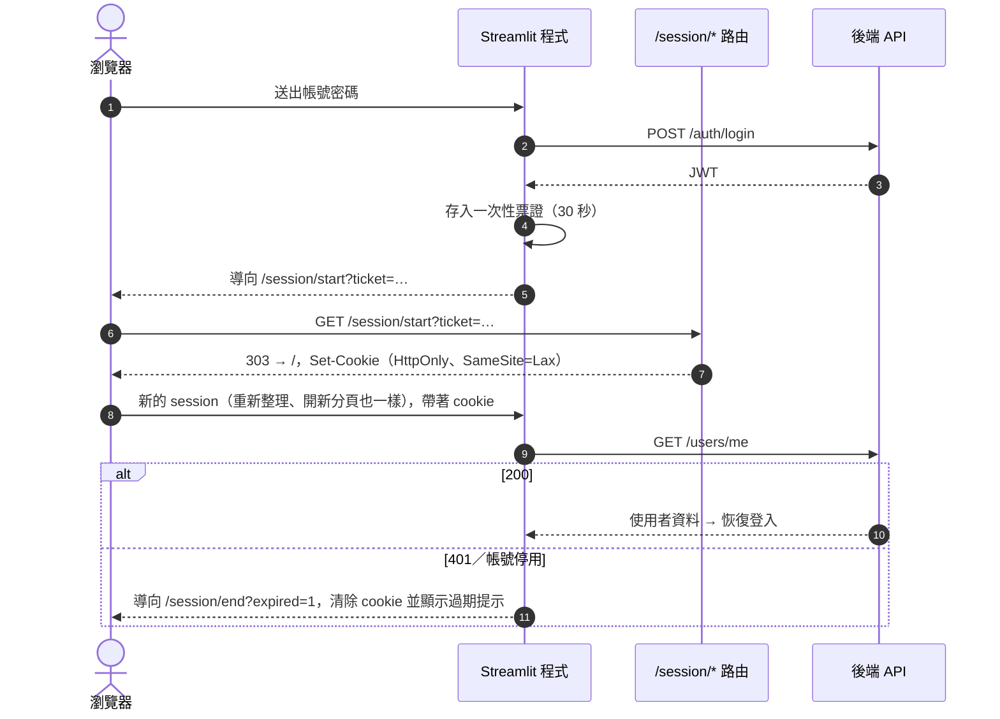
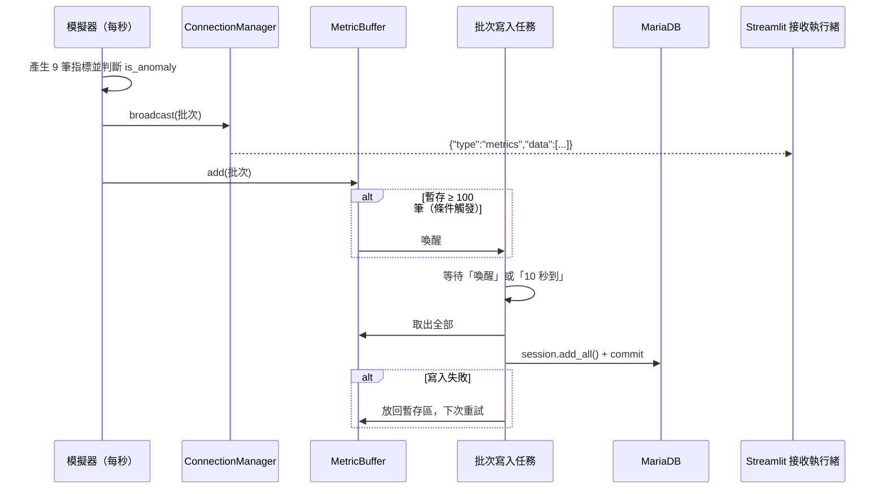
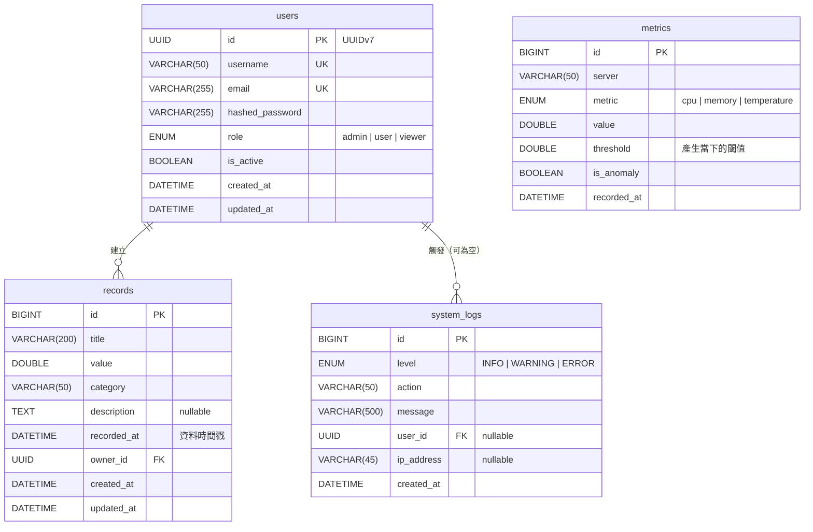

# Analytics Monitoring System

即時資料分析與監控系統：模擬多台伺服器的 CPU、記憶體與溫度指標，每秒即時推送到瀏覽器，超過閾值時以紅色標示並列入告警；同時提供手動資料記錄的管理、統計分析與 Excel 匯出，並依角色控管權限。

| 功能 | 內容 |
|---|---|
| 即時監控 | 每秒產生 3 台伺服器 × 3 種指標，經 WebSocket 推送；數值卡片、最近 60 秒折線圖（閾值線、紅色異常點）、柱狀圖、最近 20 筆告警；資料每 10 秒或滿 100 筆批次寫入資料庫 |
| 資料記錄 | 新增、查詢（分頁、分類／日期／數值／關鍵字篩選、排序）、修改、刪除；CSV/JSON 批量匯入，任一列有錯就整批不匯入並列出列號 |
| 資料分析 | 針對資料記錄或即時監控資料計算筆數、總計、平均、最大、最小；依分類或伺服器分組、依分鐘／小時／天的趨勢；下載 Excel（摘要、分組、趨勢、明細四個工作表） |
| 系統管理 | 使用者角色與啟用狀態管理、系統日誌查詢、資料庫狀態（連線、連線池、各表筆數、批次寫入狀態）、即時資料歷史查詢 |
| 認證與權限 | JWT 登入，三種角色：Admin（全部功能）、User（新增與匯入資料，只能改刪自己建立的）、Viewer（只能瀏覽與下載） |

## Demo

### 即時監控



### 資料記錄



### 資料分析



### 系統管理



## 系統架構圖

後端是單一 uvicorn 執行緒：REST API、WebSocket 推送、模擬器與批次寫入都在同一個執行緒內；前端在容器內呼叫後端，不經過瀏覽器。



### 登入流程

Streamlit 程式無法直接寫 cookie，所以登入成功後先把 token 存在記憶體並發一張一次性票證，再讓瀏覽器到前端伺服器的 `/session/start` 換成 HttpOnly cookie；token 不會出現在網址上。之後重新整理或開新分頁，都會從 cookie 恢復登入。



### 即時資料流



### ER Diagram



## 技術棧

| 層 | 技術 |
|---|---|
| 後端 | Python 3.14、FastAPI、Pydantic v2、SQLAlchemy 2.1 async ORM（asyncmy driver）、Alembic、PyJWT + bcrypt、Uvicorn |
| 前端 | Streamlit、Plotly、requests、websocket-client |
| 資料庫 | MariaDB 11.7 |
| 套件管理 | [pixi](https://pixi.sh) |
| 部署 | Docker、Docker Compose |
| 測試 | pytest、pytest-asyncio、httpx |

專案根目錄只有一份 `pixi.toml` / `pixi.lock`，以 environment 區分用途：

| environment | 內容 | 用途 |
|---|---|---|
| `backend` | 後端 + 測試套件 | 本地開發、測試容器 |
| `backend-prod` | 後端 | 後端 Docker 映像 |
| `frontend` | 前端 | 本地開發、前端 Docker 映像 |
| `lint` | ruff | 程式碼檢查與格式化 |

## Docker 部署

```bash
cp .env.example .env          # 預設值可直接使用
docker compose up -d --build
```

## 本地運行

需求：[pixi](https://pixi.sh/latest/#installation) 與 Docker（只用來跑資料庫）。以下指令都在專案根目錄執行，第一次執行時 pixi 會自動安裝對應的環境。

1. 準備環境變數。本地與 Docker 共用同一份 `.env`；後端的 pixi task 會把資料庫主機 `DB_HOST` 設為 `localhost`，不需要另外修改：

   ```bash
   cp .env.example .env    # 若尚未建立
   ```

2. 只啟動資料庫容器：

   ```bash
   docker compose up -d db
   ```

3. 建立資料表、測試帳號，並啟動後端（http://localhost:8000/docs）：

   ```bash
   pixi run -e backend migrate
   pixi run -e backend seed      # 測試帳號與範例資料（可重複執行）
   pixi run -e backend dev
   ```

4. 另開一個終端機啟動前端（http://localhost:8501）。前端的 `dev` task 已把後端位址設為 `localhost:8000`：

   ```bash
   pixi run -e frontend dev
   ```

## 測試帳號

後端啟動時會自動建立三個測試帳號（已存在就略過）。密碼取自 `.env`，以下是 `.env.example` 的預設值：

| 角色 | 帳號 | 密碼 | 權限 |
|---|---|---|---|
| Admin | `admin` | `Admin@1234` | 全部功能，含系統管理 |
| User | `user` | `User@1234` | 瀏覽、新增與匯入資料；只能修改、刪除自己建立的資料 |
| Viewer | `viewer` | `Viewer@1234` | 只能瀏覽與下載 |

資料記錄表為空時，啟動時也會建立約 200 筆最近 30 天的範例資料：各伺服器的 CPU、記憶體、溫度讀數（分類為 `cpu`、`memory`、`temperature`），大多屬於 `user`，少部分屬於 `admin`。另有 `sample_data/records.csv` 與內容相同的 `sample_data/records.json`（各 50 筆）可用來測試匯入功能。

## 主要設定

所有設定都在 `.env`（由 `.env.example` 複製），每個變數都有說明與可直接使用的預設值。常調整的有：

| 變數 | 預設值 | 說明 |
|---|---|---|
| `THRESHOLD_CPU` / `THRESHOLD_MEMORY` / `THRESHOLD_TEMPERATURE` | `90` / `90` / `80` | 異常閾值，數值大於閾值即為異常 |
| `SIMULATOR_ENABLED` / `SIMULATOR_SERVERS` | `true` / `server-1,server-2,server-3` | 模擬器開關與伺服器清單 |
| `BATCH_INTERVAL_SECONDS` / `BATCH_SIZE` | `10` / `100` | 批次寫入的時間與筆數條件 |
| `JWT_EXPIRE_MINUTES` | `60` | 登入有效時間 |
| `APP_TIMEZONE` | `Asia/Taipei` | 顯示時區；沒帶時區的輸入時間也以此解讀 |

修改後執行 `docker compose up -d` 重新建立對應的容器即可生效。

## API 文件連結

後端啟動後可開啟：

| 文件 | 位址 |
|---|---|
| Swagger UI（可直接呼叫 API） | http://localhost:8000/docs |
| ReDoc | http://localhost:8000/redoc |
| OpenAPI JSON | http://localhost:8000/openapi.json |

在 Swagger UI 按右上角 **Authorize**，輸入上面任一測試帳號的帳密，之後的請求會自動帶上 token。所有 API 前綴為 `/api/v1`，例如登入是 `POST /api/v1/auth/login`。


## 專案結構

```
.
├── backend/
│   ├── app/
│   │   ├── core/        # 設定、日誌、JWT 與密碼雜湊
│   │   ├── db/          # engine、session、Base
│   │   ├── models/      # users、records、metrics、system_logs
│   │   ├── schemas/     # Pydantic 輸入輸出
│   │   ├── routers/     # API 路由（只處理 HTTP）
│   │   ├── services/    # 商業邏輯與查詢
│   │   ├── realtime/    # 模擬器、WebSocket 連線管理、批次寫入
│   │   ├── deps.py      # 共用 dependency：session、目前使用者、角色
│   │   ├── main.py      # 建立 app、lifespan 背景任務、例外處理
│   │   └── seed.py      # 測試帳號與範例資料
│   ├── alembic/         # 資料庫遷移
│   └── tests/
├── frontend/
│   ├── server.py        # 啟動入口：app.py 加上設定／清除登入 cookie 的路由
│   ├── app.py           # 依登入狀態與角色組出頁面
│   ├── views/           # 登入、即時監控、資料記錄、資料分析、系統管理
│   └── lib/             # API 呼叫、WebSocket 接收執行緒、圖表、共用元件
├── sample_data/         # 匯入範例：records.csv、records.json
├── openspec/            # 需求規格與設計文件
├── .github/workflows/   # CI：PR 時執行 lint 與測試
├── docker-compose.yml
├── pixi.toml / pixi.lock
└── .env.example
```

## 已知限制與改進方向

- **單一後端執行緒，無法水平擴展**：模擬器、WebSocket 廣播與批次寫入都在同一個 uvicorn 執行緒內，多開 worker 會產生多份模擬資料。改進方向：模擬器獨立成服務，透過 Redis Pub/Sub 推送給多個後端。
- **登入保存在 HttpOnly cookie，有效期與 token 相同**（預設 60 分鐘）：重新整理或開新分頁會自動恢復登入，到期後需重新登入。在一個分頁登出時，同一瀏覽器的其他分頁要到重新整理或下一次操作時才會登出。前端只能有一個實例（登入時交換 cookie 的一次性票證存在記憶體中）。經由 HTTPS 存取時 cookie 會加上 Secure；若放在反向代理後面，需要讓 Streamlit 信任 `X-Forwarded-Proto`。
- **WebSocket 連線後 token 過期仍會繼續推送**：token 只在連線時檢查；推送內容是非敏感的模擬資料。斷線重連時會重新檢查，過期就登出。
- **每個瀏覽器分頁一條 WebSocket 接收執行緒**：直接關閉分頁時執行緒不會立刻結束，超過 10 分鐘沒有使用才會自行關閉。
- **metrics 資料沒有清理機制**：預設每天約 78 萬筆。分析預設只查最近 24 小時、Excel 明細最多 10,000 筆，但資料庫狀態頁以 `COUNT(*)` 計算各表筆數，長期累積後會變慢。改進方向：定期刪除或彙總舊資料、筆數改用近似值。
- **趨勢分桶使用固定時差**：MariaDB 官方映像沒有時區名稱表，所以用 `APP_TIMEZONE` 當下的時差換算。台灣沒有夏令時間不受影響；有夏令時間的時區在切換日會差 1 小時。
- **閾值只能透過環境變數調整**，無法在介面上修改。
- **沒有** refresh token、忘記密碼、Email 驗證與刪除使用者；也未處理 HTTPS、反向代理與正式環境的密鑰管理。
- **前端沒有自動化測試**：後端有完整的 pytest 測試，前端以手動操作驗證。
