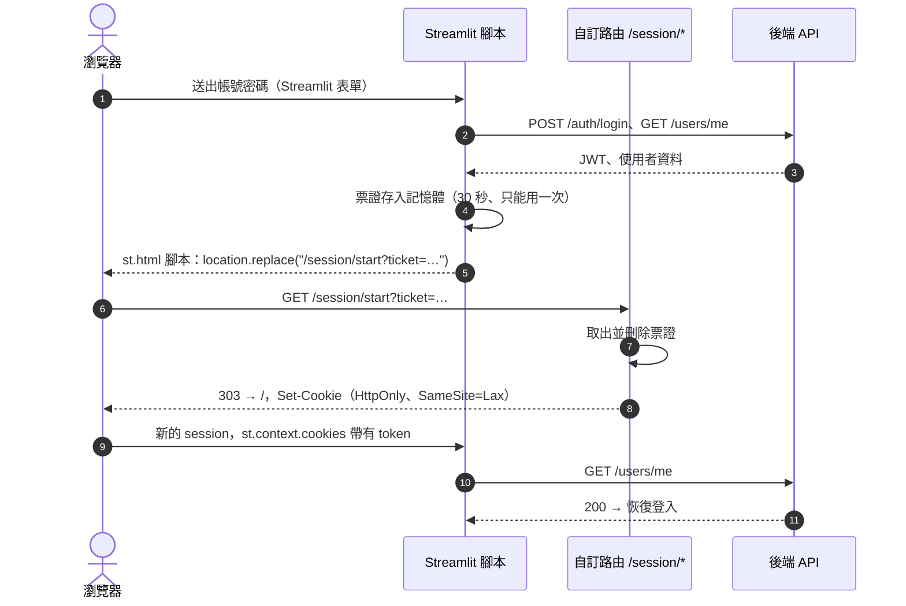

# Design

## Context

- 前端是 Streamlit。瀏覽器只和 Streamlit 伺服器溝通，後端 API 由 Streamlit 伺服器在容器內呼叫，瀏覽器不會直接收到後端的回應，所以後端無法替瀏覽器設定 cookie。
- 登入狀態目前存在 `st.session_state`（`frontend/lib/session.py`）。這份狀態只屬於一條 WebSocket 連線，重新整理就是一個新的 session。
- Streamlit 的 Python 程式碼不能直接寫 cookie。`st.context.cookies` 可以讀到建立 session 時瀏覽器送來的 cookie，但是唯讀。
- Streamlit 1.66 提供 `st.App`，可以在同一個伺服器、同一個 origin 上加 Starlette 路由，`streamlit run` 會自動偵測並啟動它。路由和 Streamlit 腳本跑在同一個行程。
- 前端只有一個容器、一個行程。

## Goals / Non-Goals

**Goals:**

- token 只放在 HttpOnly cookie，不出現在網址、瀏覽紀錄或 JavaScript 可讀的地方。
- 不新增前端套件，也不改後端。
- 恢復登入時重用現有的 `GET /users/me` 檢查，過期與停用的處理和現在一致。

**Non-Goals:**

- Refresh token 或自動延長登入。cookie 跟 JWT 一起在 `JWT_EXPIRE_MINUTES` 後失效，之後要重新登入。
- 多個前端實例共用登入狀態，例如水平擴展或 sticky session。
- 某個分頁登出時，即時讓其他已開啟的分頁也登出。其他分頁會在下一次重新整理或呼叫 API 時才發現。

## Decisions

### 1. 由 Streamlit 伺服器的自訂路由設定 cookie

新增入口檔 `frontend/server.py`，內容是 `app = st.App("app.py", routes=[...])`，掛上兩個路由：

| 路由 | 作用 |
|---|---|
| `GET /session/start?ticket=…` | 用一次性票證換取 token，設定 cookie，以 303 導回 `/` |
| `GET /session/end[?expired=1]` | 刪除 cookie，以 303 導回 `/`（帶 `expired=1` 時導回 `/?expired=1`） |

路徑避開 Streamlit 保留的 `/_stcore/`、`/media/`、`/component/`、`/static/`，也避開 `st.login` 使用的 `/auth/`。

考慮過的其他做法：

- **第三方 cookie 元件**（例如 streamlit-cookies-controller）：要多一個依賴，而且 cookie 由 JavaScript 寫入，不能是 HttpOnly。
- **localStorage**：同樣會被 JavaScript 讀到，伺服器端也讀不到，得再傳一次。
- **登入頁改成原生 HTML 表單，直接 POST 到自訂路由**：不需要票證，但登入表單會脫離 Streamlit 元件。錯誤訊息要靠網址參數傳遞，樣式也和其他頁面不一致。

### 2. 用一次性票證把 token 交給瀏覽器

登入表單維持 Streamlit 元件。流程如下：

- 票證是 `secrets.token_urlsafe(32)`。它存在模組層級的 dict 裡，用 lock 保護，30 秒內有效，取出即刪除。存入和取出時都會順便清掉過期的票證。
- 網址上只出現票證，不出現 JWT。票證被看到也無法重複使用，30 秒後也會失效。
- 導向使用 `st.html(..., unsafe_allow_javascript=True)`。內容只有固定的程式碼和伺服器產生的票證，沒有使用者輸入。

考慮過的其他做法：把 JWT 直接放在 `/session/start?token=…`。這樣比較簡單，但 token 會留在瀏覽紀錄和伺服器日誌中，所以不採用。

### 3. Cookie 屬性

- 名稱 `ams_session`，`Path=/`，`HttpOnly`，`SameSite=Lax`。
- `Max-Age` 取自 JWT 的 `exp` claim。這裡只解 base64 讀取到期時間，不驗證簽章，驗證仍由後端在每次呼叫時負責。這樣前端不必另外知道 `JWT_EXPIRE_MINUTES`，兩邊也不會不一致。
- 請求為 HTTPS 時加上 `Secure`。依據是 `request.url.scheme`；放在反向代理後面時，需要讓 uvicorn 信任 `X-Forwarded-Proto`。

### 4. 恢復登入

`app.py` 在決定顯示哪些頁面之前，如果 session 尚未登入、但 `st.context.cookies` 有 `ams_session`，就呼叫 `GET /users/me`：

- **200：** `session.start(token, me)`，接著照常建立導覽。網址若是 `/records`，就直接停在資料記錄頁。
- **401，或停用帳號的 403：** 導向 `/session/end?expired=1`，清掉 cookie 並顯示過期提示。
- **連線失敗或 5xx：** 沿用現有的錯誤訊息，不清 cookie，後端恢復後重新整理即可。

每個 session 只檢查一次，之後的頁面切換不會重複呼叫。

### 5. 登出與過期改為導向 `/session/end`

- **登出按鈕：** `session.end()` 停止接收執行緒並清空 `session_state`，然後導向 `/session/end`。
- **401、停用帳號的 403、WebSocket 1008：** 同上，但導向 `/session/end?expired=1`。
- **過期提示：** 原本存在 `st.session_state.notice`，但整頁重新載入後會遺失，所以改由登入頁讀取 `st.query_params["expired"]` 顯示，顯示後移除該參數。

### 6. 啟動方式

- `frontend/entrypoint.sh` 與 pixi 的 frontend `dev` task 改為 `streamlit run server.py`，其餘參數不變。
- `app.py` 仍是頁面腳本，不需要知道自己是從 `st.App` 啟動的。
- Compose 健康檢查的 `/_stcore/health` 不變。

## Risks / Trade-offs

- **[票證存在單一行程的記憶體]：** 前端改成多個實例時，`/session/start` 可能打到沒有該票證的實例。→ 目前只有一個前端容器。要擴展時，改用共享儲存（例如 Redis），或啟用 sticky session。
- **[登出路由是 GET，可被跨站觸發]：** 別的網站可以讓使用者被登出。→ 影響只是被登出，不會洩漏資料或改變資料。
- **[st.App 是較新的 API]：** 之後升級 Streamlit 時，介面可能變動。→ pixi 已限定 `streamlit >=1.66.1,<2`，升級時先在本地驗證登入流程。
- **[導向時畫面會閃一下]：** 登入、登出時整頁重新載入。→ 只發生在登入與登出，可以接受。
- **[其他分頁不會即時登出]：** 同一瀏覽器的其他分頁仍保有各自的 session，直到重新整理或 token 失效。→ 已列為 Non-Goal，README 會說明。
- **[前端沒有自動化測試]：** 這次的邏輯都在前端。→ 用 curl 驗證路由與 cookie 屬性，再依規格情境在瀏覽器逐一手動驗證。

## Migration Plan

- 部署即生效，不需要資料遷移。
- 舊版本的使用者在重新整理後，因為沒有 cookie，會看到登入頁，登入一次之後就會保存。
- 回復方式：把 entrypoint 與 pixi task 改回 `streamlit run app.py`，並還原 `session.py`、`app.py`、`login.py`。瀏覽器中殘留的 cookie 在 JWT 到期後自然失效，不會影響舊版。
